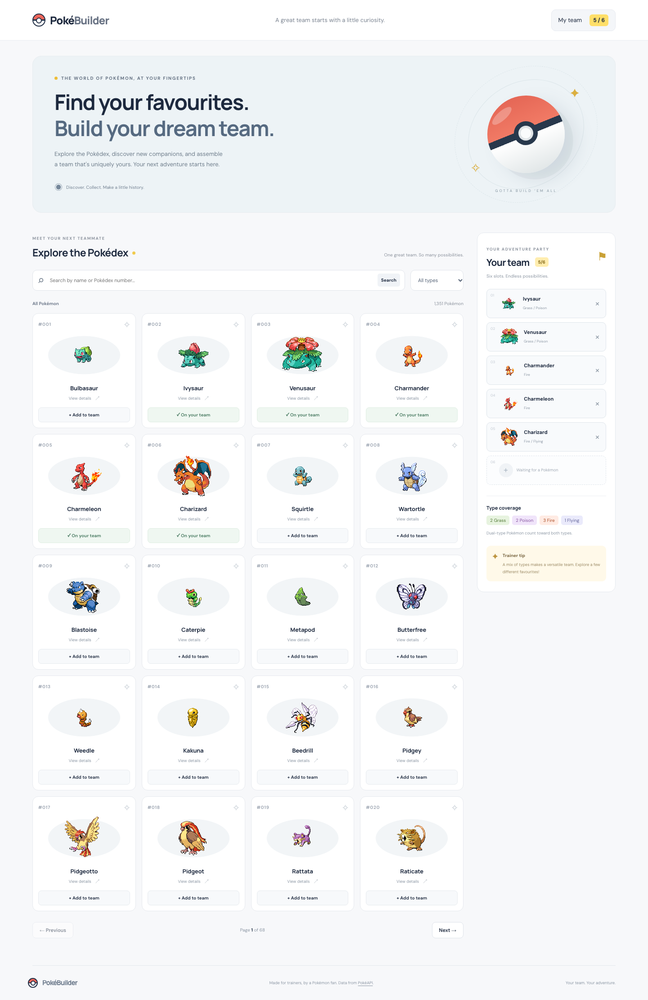
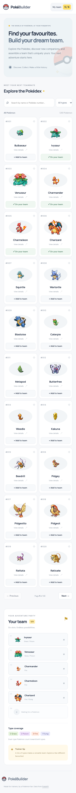

# Pokémon Team Builder

Browse the Pokédex, inspect Pokémon stats, and assemble a team of up to six. A responsive learning project built with React function components, JavaScript, Vite, plain CSS, and native Fetch. No backend, UI library, or data-fetching library.

## Run locally

Use Node.js 22.12+ (or 20.19+) and npm. The project was developed with Node 24.

```sh
cd pokemon-team-builder
npm install
npm run dev
```

Open the URL printed by Vite. Internet access is required for PokéAPI, sprite images, and optional Google Fonts; system fonts are the fallback.

```sh
npm run build     # Production files in dist/
npm run preview   # Preview the build locally
npm run lint      # Oxlint checks JavaScript and JSX
```

## Features

- Browse 20 Pokémon per page; previous/next navigation and page counts.
- Case-insensitive name or ID search with whitespace trimming, submit, clear, and 500 ms debounce.
- Native accessible details dialog: types, metric measurements, six base stats, and visual stat meters. Escape closes it and restores focus.
- Six team slots, immediate counters, duplicate/full-team messages, and removal.
- Loading indicators, separate 404/network error messages, retry controls, image fallbacks, and empty states.
- Mobile layouts, keyboard focus indicators, live status messages, and reduced-motion support.

Completed stretch goals: paginated type filtering, localStorage persistence with validation and duplicate removal, type breakdown, debounced search, and consistent type colours. Searching takes precedence over the selected type; clearing search restores that filter. Type controls are disabled while search text is present. Dual-type Pokémon contribute to both counts.

## Component structure

```text
src/
  main.jsx                     React entry point and StrictMode
  App.jsx                      Shared state, effects, and event handlers
  App.css                      Page layout and responsive component styles
  index.css                    Global typography and element defaults
  components/
    Header.jsx                 Branding and team counter
    SearchBar.jsx              Controlled search and type selector
    PokemonGrid.jsx            List rendering with Pokémon IDs as keys
    PokemonCard.jsx            Detail and add actions
    PokemonImage.jsx           Shared sprite and unavailable-image fallback
    PokemonDetails.jsx         Native modal, measurements, and stats
    Pagination.jsx             Navigation and disabled states
    Team.jsx                   Six slots and computed type summary
    TeamMember.jsx             Member display and remove control
    Loading.jsx                Accessible loading state
    ErrorMessage.jsx           Error text and retry action
  services/pokemonApi.js       Fetch, response validation, caching, transforms
  styles/components.css        Type colours and detail dialog styles
```

## React concepts to explain in a review

`App` lifts shared state above the grid and team. Children receive props and call callback props rather than changing parent state. Search is a controlled input: its value comes from state and `onChange` updates that state. Conditional rendering selects loading, error, results, or empty content.

The browse effect depends on the normalized query, type, page, and retry counter. Changing a dependency triggers a new request. Its cleanup aborts the previous request and marks its result inactive, preventing an older response from overwriting newer results. A separate effect loads details; another saves the team. The debounce effect clears its timer during cleanup. `try/catch/finally` ensures errors are handled and loading flags are reset.

Team updates use functional setters with spread and `filter`, preserving immutability. Pokémon IDs provide stable list keys. Empty team slots use fixed position keys because they represent six permanent positions. The type summary is derived during rendering rather than stored as another state value.

## PokéAPI integration and image trade-off

- List: `https://pokeapi.co/api/v2/pokemon?limit=20&offset=0`
- Details/search: `https://pokeapi.co/api/v2/pokemon/{name-or-id}`
- Type filter: `https://pokeapi.co/api/v2/type/{type}`

The service checks `response.ok` before JSON parsing, distinguishes 404, and catches network failures. Successful JSON is cached in memory for the browser session; failures are retryable. Effect cleanup also runs in development StrictMode, so a canceled initial request can appear in the network panel.

The list contains only names and URLs. We extract the numeric ID from each URL and construct `https://raw.githubusercontent.com/PokeAPI/sprites/master/sprites/pokemon/{id}.png`. A normal page therefore needs **one JSON request instead of 21**. Image requests still happen independently. This trades immediate type/stat information on cards for fewer API calls. Full data is loaded only for a search, details, or adding a team member (which needs types). Heights and weights are divided by 10 to convert decimetres/hectograms into metres/kilograms.

Type data is fetched once per type, cached, and sliced into 20-member pages locally. Team changes are independent of the browsing state. Stored teams are checked for valid IDs, names and type structures, deduplicated, and capped at six; corrupt or inaccessible storage does not crash the app.

## Challenges and trade-offs

The main challenges were coordinating asynchronous searches and pagination, preventing stale responses, and keeping the team independent of browsing. AbortController plus an effect-local active flag makes those lifecycles explicit. Separate browse/detail loading states prevent a modal request from hiding the grid. An add request fetches only necessary detail data and disables its card until complete.

The JSON cache lasts for one session and has no eviction, which is adequate for this small learning app. The team summary describes type representation, not competitive strengths or weaknesses. Network and image availability depend on third-party services.

## Verification

See [TESTING.md](TESTING.md) for executed checks and a manual checklist. Production build and lint are required before submission. Browser checks use temporary Playwright tooling outside the application; Playwright is not a project dependency.

## Future improvements

- Ability/weakness analysis, team reordering, and sharing through a URL.
- An offline strategy and bounded cache for a larger Pokédex app.
- More automated accessibility checks and cross-browser coverage.

## Screenshots





## Submission links

- GitHub repository: **TODO — add your repository URL**
- Live demo: **TODO — add your deployment URL**

No repository push or deployment is performed automatically. Pokémon names and sprites belong to their respective owners. Data is supplied by [PokéAPI](https://pokeapi.co/).

## Continuous integration

The repository-root `.github/workflows/ci.yml` runs on pushes, pull requests, and manual dispatch. It uses Ubuntu and Node.js 24, installs locked dependencies with `npm ci`, runs `npm run lint -- --deny-warnings`, and builds the production bundle. Commands run inside `pokemon-team-builder/`; npm caching uses that folder's lockfile. No secrets or deployment permissions are required.

To reproduce the checks locally, run these commands from `pokemon-team-builder/`:

```sh
npm ci
npm run lint -- --deny-warnings
npm run build
```

View hosted results in the repository's **Actions → CI** tab after the workflow is pushed. CI currently checks lint and build; the browser verification documented in TESTING.md is separate.
